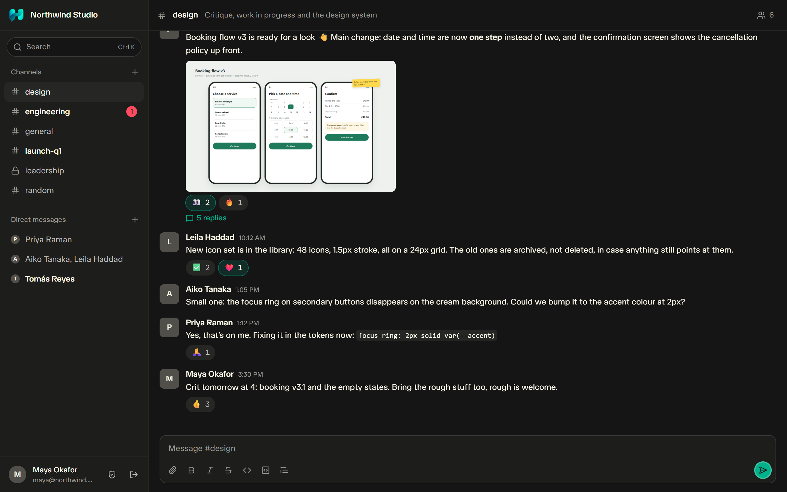
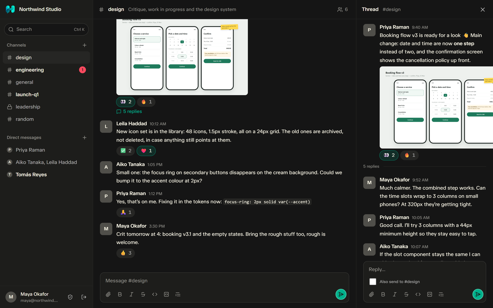
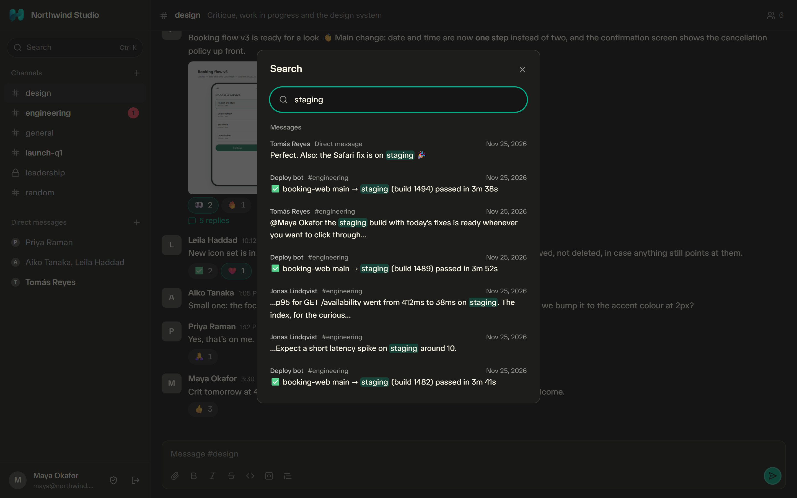

# Huddle

Free team chat that runs on your own Cloudflare account. Channels, threads, direct messages, search and file sharing, with no per-seat fees and no one else holding your messages.

No passwords: sign in with an authenticator app, an emailed code, or Google or GitHub. Huddle is invite-only, and owners choose whether members can invite people too.

**Website and docs: [huddlechat.co.za](https://huddlechat.co.za)**



| Threads | Search |
| --- | --- |
|  |  |

## Get your own

[](https://deploy.workers.cloudflare.com/?url=https://github.com/Pieter1821/Huddle-Team-Chat)

Deploying creates the Worker, database, file storage and queue in your account. Open the new address, sign in with the admin email you entered, and follow the page. The full walkthrough is in the [docs](https://huddlechat.co.za).

## Run it locally

```
npm install
cp .dev.vars.example .dev.vars   # set ADMIN_EMAIL and BETTER_AUTH_SECRET
npm run dev
```

## Contributing

Contributions of every size are welcome. Start with [CONTRIBUTING.md](CONTRIBUTING.md), or pick up an issue labelled [good first issue](https://github.com/Pieter1821/Huddle-Team-Chat/labels/good%20first%20issue).

## License

[MIT](LICENSE)
